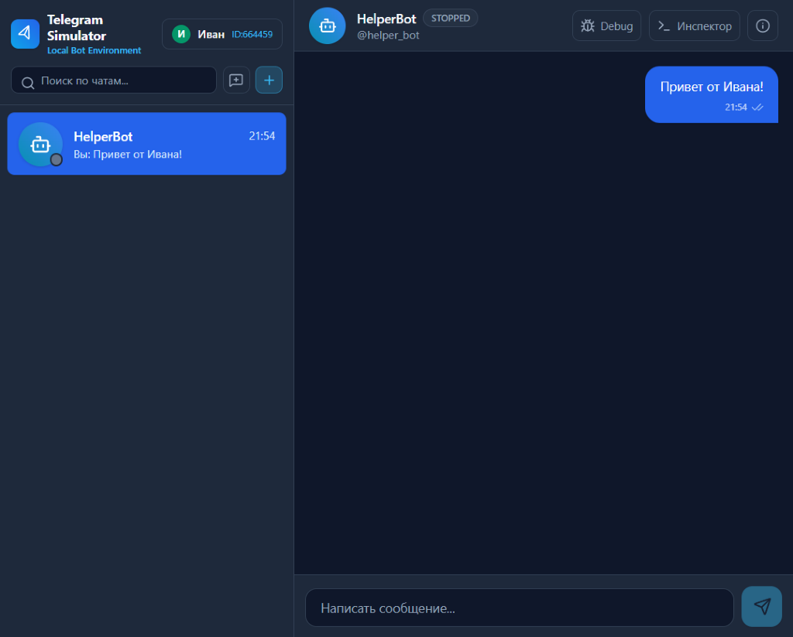

# Telegram Simulator 🚀

<p align="center">
  <b>Локальная среда разработки, тестирования и симуляции Telegram-ботов для Python</b><br>
  <b>Local Development, Testing & Simulation Environment for Python Telegram Bots</b>
</p>

<p align="center">
  <a href="#-русский">Русский 🇷🇺</a> •
  <a href="#-english">English 🇬🇧</a>
</p>

<p align="center">
  
</p>

---

## 🇷🇺 Русский

### Оглавление
1. [О проекте](#о-проекте)
2. [Архитектура системы](#архитектура-системы)
   - [Компонентная схема](#компонентная-схема)
   - [Подсистема 1: Эмулятор Telegram Bot API (Backend)](#подсистема-1-эмулятор-telegram-bot-api-backend)
   - [Подсистема 2: Process Manager (Управление дочерними процессами)](#подсистема-2-process-manager-управление-дочерними-процессами)
   - [Подсистема 3: Графический интерфейс Telegram Desktop (Frontend)](#подсистема-3-графический-интерфейс-telegram-desktop-frontend)
   - [Шина событий WebSocket и модель данных SQLite](#шина-событий-websocket-и-модель-данных-sqlite)
3. [Технологический стек](#технологический-стек)
4. [Подключение ботов (Подмена URL Telegram Bot API)](#подключение-ботов-подмена-url-telegram-bot-api)
   - [Как работает симуляция и концепция подмены](#как-работает-симуляция-и-концепция-подмены)
   - [Подмена в pyTelegramBotAPI (telebot)](#1-подмена-в-pytelegrambotapi-telebot)
   - [Подмена в aiogram 3](#2-подмена-в-aiogram-3)
5. [Варианты развертывания и быстрый старт](#варианты-развертывания-и-быстрый-старт)
   - [Вариант А: Запуск через автономный .exe для Windows (без Python и Node.js)](#вариант-а-запуск-через-автономный-exe-для-windows-без-python-и-nodejs)
   - [Вариант Б: Запуск из исходного кода](#вариант-б-запуск-из-исходного-кода)
   - [Сборка собственного .exe через PyInstaller](#сборка-собственного-exe-через-pyinstaller)
6. [Полная инструкция: как создать своего бота и открыть его через веб](#полная-инструкция-как-создать-своего-бота-и-открыть-его-через-веб)
7. [Поддерживаемые методы Bot API](#поддерживаемые-методы-bot-api)
8. [Тестирование](#тестирование)
9. [Структура проекта](#структура-проекта)
10. [Безопасность и продакшн-рекомендации](#безопасность-и-продакшн-рекомендации)
11. [Лицензия](#лицензия)

---

### О проекте

**Telegram Simulator** — это полноценная локальная учебная платформа и автономная среда разработки, позволяющая создавать, запускать и тестировать Telegram-ботов на языке Python без необходимости подключения к серверам Telegram, без VPN, прокси и без использования боевых API-токенов.

#### Ключевая концепция:
- **Никаких самописных библиотек и поддельных классов**: код ученика или разработчика использует настоящие, установленные из PyPI официальные библиотеки `pyTelegramBotAPI` (`telebot`) и `aiogram 3`.
- **Эмуляция на уровне протокола HTTP**: симулятор имитирует поведение официальных серверов Telegram Bot API (`https://api.telegram.org`), обрабатывая входящие HTTP-запросы и формируя настоящие объекты `Update`.
- **Полноценный интерфейс Telegram Desktop**: графическая веб-оболочка в точности воспроизводит работу клиента Telegram (диалоги, сообщения, интерактивные Inline- и Reply-клавиатуры, переключение между виртуальными пользователями) и содержит встроенную панель разработчика (Console, Updates Inspector, API Inspector).

---

### Архитектура системы

Система построена по принципу слабой связанности (loose coupling) и состоит из трёх независимых подсистем, взаимодействующих по стандартным протоколам HTTP, WebSocket и IPC (межпроцессное взаимодействие OS).

#### Компонентная схема

```text
+--------------------------------------------------------------------------------------------------+
|                                        TELEGRAM SIMULATOR                                        |
|                                                                                                  |
|   +------------------------------------+               +-------------------------------------+   |
|   |         Frontend (SPA UI)          |               |       Process Manager (Host)        |   |
|   |  - React 19 + TypeScript           |               |  - subprocess.Popen isolation       |   |
|   |  - Tailwind CSS + Lucide Icons     |               |  - Lifecycle: START/RUN/STOP/ERROR  |   |
|   |  - Chat Area & Keyboards           |               |  - Background daemon threads        |   |
|   |  - Developer Inspector             |               |  - Real-time stdout/stderr capture  |   |
|   +------------------------------------+               +-------------------------------------+   |
|           ^                    ^                                          |                      |
|           | REST API           | WebSocket (/ws)                          v OS process spawn     |
|           v                    v                               +---------------------+           |
|   +------------------------------------+                       |  Student Bot (Py)   |           |
|   |     Backend Server (FastAPI)       |                       |  - telebot          |           |
|   |  - Bot API Router (/bot<tok>/<m>)  |                       |  - aiogram 3        |           |
|   |  - Long Polling Queue Manager      | <-------------------- |  - Original code    |           |
|   |  - Update Factory (msg/callback)   |   HTTP Bot API calls  +---------------------+           |
|   |  - Central EventBus (asyncio)      |   (getUpdates, sendMessage, editMessage...)             |
|   |  - SQLite (SQLAlchemy 2.x Async)   |                                                         |
|   +------------------------------------+                                                         |
+--------------------------------------------------------------------------------------------------+
```

---

#### Подсистема 1: Эмулятор Telegram Bot API (Backend)

Ядро системы — локальный HTTP-сервер на FastAPI, реализующий спецификацию Telegram Bot API.

1. **Маршрутизация эндпоинтов**:
   - Роутер перехватывает все вызовы по пути `/bot{token}/{method_name}`.
   - Поддерживает как `GET`, так и `POST` запросы.
   - Корректно парсит данные из `application/json`, `application/x-www-form-urlencoded` и `multipart/form-data` (для загрузки файлов и медиа).
   - Выполняет валидацию токена формата `<bot_id>:<secret>` по базе данных с возвратом ошибки `401 Unauthorized` в стандартном формате Telegram при неверном токене.

2. **Архитектура Long Polling (`UpdateQueueManager`)**:
   - Каждому виртуальному боту выделяется изолированная асинхронная очередь `asyncio.Queue` / `UpdateQueue`.
   - **Подтверждение и защита от дублей (`offset`)**: при передаче параметра `offset` все ранее подтверждённые события с `update_id < offset` безвозвратно удаляются из очереди бота.
   - **Неблокирующее ожидание (`timeout`)**: если очередь пуста, а параметр `timeout > 0`, запрос не блокирует поток, а засыпает на `asyncio.Event`. Как только в чате происходит действие (сообщение или нажатие кнопки), событие взводится и запрос мгновенно возвращает новые `Update`.
   - **Фильтрация `allowed_updates`**: бот получает только те типы событий (`message`, `edited_message`, `callback_query`), на которые он подписался.
   - **Безопасная остановка**: при завершении процесса бота очередь принудительно разблокируется и возвращает пустой массив `[]`, предотвращая зависание соединений.

3. **Фабрика событий (Update Factory)**:
   - Автоматически инкрементирует глобальный `update_id`.
   - Генерирует валидные структуры Telegram-объектов: `Message`, `User`, `Chat`, `CallbackQuery`.
   - Поддерживает сущности `reply_to_message`, `forward_from`, `edit_date` и `parse_mode`.

---

#### Подсистема 2: Process Manager (Управление дочерними процессами)

Менеджер процессов отвечает за запуск пользовательских Python-файлов, предотвращая сбои основного сервера:

1. **Изоляция исполнения**:
   - Пользовательский код выполняется в отдельном независимом процессе операционной системы через `subprocess.Popen`.
   - Любое аварийное завершение пользовательского бота (`SyntaxError`, необработанное исключение, `sys.exit`) никак не влияет на работу веб-интерфейса и сервера FastAPI.
2. **Асинхронный перехват потоков вывода**:
   - Фоновые демонические потоки (threads) с построчной буферизацией непрерывно вычитывают каналы `stdout` и `stderr`.
   - Каждая строка вывода или стек ошибки (traceback) моментально упаковывается в событие `process_log` и через `EventBus` передаётся по WebSocket в консоль интерфейса.
3. **Контроль жизненного цикла**:
   - Статусы процесса: `STOPPED` ➔ `STARTING` ➔ `RUNNING` ➔ `STOPPING` ➔ `ERROR`.
   - Корректная остановка: отправка сигнала завершения (`SIGTERM` / `terminate()`), ожидание 3 секунды и принудительное завершение (`kill()`) при необходимости.
   - Фиксация PID и кода завершения процесса (`exit_code`).

---

#### Подсистема 3: Графический интерфейс Telegram Desktop (Frontend)

Клиентское приложение на React 19, TypeScript и Tailwind CSS с компонентной архитектурой:

1. **Область чата (Telegram View)**:
   - Список диалогов с динамическим поиском, аватарами и превью последних сообщений.
   - Окно сообщений с визуальным разделением исходящих (пользователь) и входящих (бот) сообщений.
   - **InlineKeyboardMarkup**: кнопки отображаются внутри пузыря сообщения. При клике формируется и отправляется реальное событие `CallbackQuery` с `callback_data`. Отображаются всплывающие уведомления (toast), если бот вызвал метод `answerCallbackQuery(text=..., show_alert=True)`.
   - **ReplyKeyboardMarkup**: панель кнопок быстрого ответа над полем ввода. Поддерживает параметры `resize_keyboard`, `input_field_placeholder` и команду скрытия `ReplyKeyboardRemove`.
2. **Переключатель виртуальных пользователей (User Switcher)**:
   - Позволяет в один клик переключаться между разными виртуальными учениками/пользователями (`Alice`, `Bob`, `Charlie`).
   - Позволяет тестировать многопользовательские сценарии, изоляцию состояний FSM и групповую логику.
3. **Панель разработчика (Developer Panel)**:
   - **Console**: live-трансляция консольного вывода (`stdout`, `stderr`, трассировки исключений Python) в реальном времени.
   - **Updates Inspector**: таблица сгенерированных событий `Update` с возможностью просмотра полного древовидного JSON-объекта каждого апдейта.
   - **API Inspector**: журнал всех входящих HTTP-запросов к Bot API с деталями: метод, HTTP-статус, переданные параметры, тело ответа и время выполнения в миллисекундах.

---

#### Шина событий WebSocket и модель данных SQLite

1. **WebSocket EventBus (`/ws`)**:
   Централизованная асинхронная шина событий на бэкенде рассылает сообщения всем подключенным веб-клиентам:

| Тип события | Назначение |
|---|---|
| `chat_message` | Новое входящее или исходящее сообщение в чате |
| `message_edit` | Изменение текста сообщения или его inline-клавиатуры |
| `message_delete` | Удаление сообщения из чата |
| `process_log` | Строка вывода бота (`stdout`, `stderr`, `system`) |
| `process_status` | Смена статуса процесса (`RUNNING`, `STOPPED`, `ERROR`) |
| `update_event` | Фиксация объекта Update для Updates Inspector |
| `api_request` | Фиксация HTTP-вызова Bot API для API Inspector |
| `callback_query_answered` | Результат ответа на нажатие инлайн-кнопки |

2. **Персистентность (SQLite + SQLAlchemy 2.x Async)**:
   Все сущности сохраняются в локальную базу данных `backend/data/telegram_simulator.db`:
   - `Bot`: виртуальные боты (имя, username, токен, статус).
   - `User`: виртуальные пользователи симулятора.
   - `Chat`: диалоги пользователей с ботами.
   - `Message`: история сообщений с типами медиа, текстом и JSON-структурами клавиатур.
   - `UpdateRecord` и `ApiRequest`: архив инспектора для последующего анализа работы ботов.

---

### Технологический стек

- **Backend**: Python 3.12+, FastAPI, Uvicorn, Pydantic v2, SQLAlchemy 2.x (Asyncio + aiosqlite), SQLite, WebSockets, httpx.
- **Frontend**: React 19, TypeScript, Vite, Tailwind CSS, Lucide React.
- **Process Management**: `subprocess.Popen` с неблокирующими потоками чтения вывода и потокобезопасной передачей событий через `asyncio.run_coroutine_threadsafe`.
- **Testing**: pytest, pytest-asyncio, httpx AsyncClient (ASGITransport).

---

### Подключение ботов (Подмена URL Telegram Bot API)

#### Как работает симуляция и концепция подмены

Telegram-боты не используют закрытый бинарный протокол. Любая библиотека (`telebot`, `aiogram 3`, `python-telegram-bot`) отправляет стандартные HTTP REST-запросы к официальному серверу:
```text
https://api.telegram.org/bot<TOKEN>/<METHOD>
```

**Telegram Simulator** запускает локальный HTTP-сервер на `http://127.0.0.1:8000`, полностью повторяющий эту иерархию:
```text
http://127.0.0.1:8000/bot<TOKEN>/<METHOD>
```

Поэтому для переключения бота на локальный симулятор требуется лишь перенаправить базовый URL запросов в конфигурации используемой библиотеки. Никаких правок библиотек, monkey-patching или изменения кода обработчиков не требуется — студенты пишут 100% настоящий код.

---

#### 1. Подмена в pyTelegramBotAPI (telebot)

В `telebot` за сетевой транспорт и базовые адреса запросов отвечает встроенный модуль `apihelper`. По умолчанию `apihelper.API_URL` равен `"https://api.telegram.org/bot{0}/{1}"`.

```python
import telebot

# =====================================================================
# [СТРОЧКИ ДЛЯ ПОДМЕНЫ API]
# =====================================================================
# 1. Импортируем служебный модуль сетевых настроек библиотеки telebot:
from telebot import apihelper

# 2. Перенаправляем базовый адрес запросов на локальный эмулятор:
#    {0} библиотека автоматически заменит на токен бота, а {1} — на имя метода (getMe, sendMessage и т.д.)
apihelper.API_URL = "http://127.0.0.1:8000/bot{0}/{1}"
# =====================================================================

# Токен берется из интерфейса Telegram Simulator при создании виртуального бота
bot = telebot.TeleBot("1:SIMULATOR_TOKEN")


# --- Дальше идёт стандартный, неизменный код вашего бота ---
@bot.message_handler(commands=["start"])
def start(message):
    bot.reply_to(message, "Привет! Я работаю в локальном симуляторе!")


@bot.message_handler(func=lambda msg: True)
def echo(message):
    bot.send_message(message.chat.id, f"Эхо: {message.text}")


if __name__ == "__main__":
    bot.infinity_polling()
```

**Построчное объяснение добавленных строк:**
- `from telebot import apihelper` — импортирует внутренний модуль `telebot`, управляющий параметрами HTTP-сессии, таймаутами и базовыми эндпоинтами.
- `apihelper.API_URL = "http://127.0.0.1:8000/bot{0}/{1}"` — переопределяет глобальный шаблон адреса Telegram Bot API. Все вызовы библиотеки (`infinity_polling`, `sendMessage`, `editMessageText` и др.) вместо удалённого `https://api.telegram.org` отправляются на локальный сервер `127.0.0.1:8000`.

---

#### 2. Подмена в aiogram 3

В `aiogram 3` архитектура модульная: базовый URL настраивается через класс `TelegramAPIServer`, передаётся в клиентскую HTTP-сессию (`AiohttpSession`), а сессия передаётся в объект `Bot`.

```python
import asyncio
from aiogram import Bot, Dispatcher
from aiogram.filters import CommandStart
from aiogram.types import Message

# =====================================================================
# [СТРОЧКИ ДЛЯ ПОДМЕНЫ API]
# =====================================================================
# 1. Импортируем классы сессии aiohttp и фабрики адресов Telegram Bot API:
from aiogram.client.session.aiohttp import AiohttpSession
from aiogram.client.telegram import TelegramAPIServer

# 2. Создаем конфигурацию сервера API с адресом локального симулятора:
API = TelegramAPIServer.from_base("http://127.0.0.1:8000")

# 3. Создаем асинхронную HTTP-сессию, использующую локальный API-сервер:
session = AiohttpSession(api=API)

# 4. Передаем сессию с подмененным адресом в конструктор Bot:
bot = Bot(token="1:SIMULATOR_TOKEN", session=session)
# =====================================================================

dp = Dispatcher()


# --- Дальше идёт стандартный асинхронный код на aiogram 3 ---
@dp.message(CommandStart())
async def start(message: Message):
    await message.answer("Привет! Я асинхронный бот на aiogram 3!")


@dp.message()
async def echo(message: Message):
    await message.answer(f"Эхо: {message.text}")


async def main():
    try:
        await dp.start_polling(bot)
    finally:
        # Корректно закрываем сессию при завершении работы программы
        await session.close()


if __name__ == "__main__":
    asyncio.run(main())
```

**Построчное объяснение добавленных строк:**
- `from aiogram.client.session.aiohttp import AiohttpSession` — импортирует стандартный транспортный клиент `aiohttp`, через который aiogram осуществляет все асинхронные сетевые запросы.
- `from aiogram.client.telegram import TelegramAPIServer` — импортирует класс конфигурации эндпоинтов Telegram Bot API (по умолчанию настроен на официальный облачный сервис `https://api.telegram.org`).
- `API = TelegramAPIServer.from_base("http://127.0.0.1:8000")` — фабричный метод, создающий правила генерации URL для вызова методов и скачивания файлов с базовым хостом `http://127.0.0.1:8000`.
- `session = AiohttpSession(api=API)` — инициализирует сессию с подменённым адресом сервера API.
- `bot = Bot(token="...", session=session)` — связывает бота с созданной сессией. В результате `start_polling` и все методы отправки данных стучатся напрямую в эмулятор.

---

### Варианты развертывания и быстрый старт

#### Вариант А: Запуск через автономный .exe для Windows (без Python и Node.js) ⚡

Если вам или вашим ученикам нужно просто запустить Telegram Simulator без установки Python, Node.js, компиляторов и зависимостей:

1. Перейдите в раздел **[GitHub Releases](https://github.com/rillside/telegram-bot-simulator/releases)**.
2. Скачайте архив **`telegram-simulator-windows-x64.zip`** (или напрямую `telegram-simulator.exe`).
3. Распакуйте архив в любую удобную папку и запустите **`telegram-simulator.exe`**.
4. Программа автоматически запустит локальный сервер и откроет веб-интерфейс в вашем браузере по адресу:  
   👉 **[http://127.0.0.1:8000](http://127.0.0.1:8000)**
5. Все базы данных, история чатов и загруженные файлы будут автоматически сохраняться в папку `data/` рядом с `.exe` файлом.

---

#### Вариант Б: Запуск из исходного кода

Если вы хотите запустить проект в режиме разработки или модифицировать его:

##### 1. Установка зависимостей Backend
```bash
pip install -r backend/requirements.txt
```

##### 2. Сборка Frontend SPA
```bash
cd frontend
npm install
npm run build
cd ..
```
*(Собранный статический бандл раздается сервером FastAPI автоматически).*

##### 3. Запуск платформы
```bash
python run.py
```
*(или `python backend/app/main.py`).*

После запуска откройте браузер:  
👉 **[http://127.0.0.1:8000](http://127.0.0.1:8000)**

---

#### Сборка собственного .exe через PyInstaller
Вы можете самостоятельно пересобрать автономный Windows-исполняемый файл одной командой:
```bash
python scripts/build_exe.py
```
Готовый бинарник `telegram-simulator.exe` и релизный ZIP-архив появятся в папке `dist/`.

---

### Полная инструкция: как создать своего бота и открыть его через веб

Ниже приведено пошаговое руководство от создания виртуального бота до отправки первого сообщения и отладки.

#### Шаг 1. Создание нового виртуального бота в веб-интерфейсе
1. Откройте интерфейс в браузере по адресу `http://127.0.0.1:8000`.
2. В левой боковой панели (Sidebar) нажмите кнопку **"+ Новый бот"**.
3. В открывшемся модальном окне заполните поля:
   - **Название бота**: читаемое имя, например `Мой Первый Бот`.
   - **Username**: юзернейм бота (должен оканчиваться на `bot`), например `my_test_bot`.
   - **Описание** (необязательно): краткий текст о назначении бота.
4. Нажмите **"Создать бота"**.
5. Бот появится в списке диалогов слева, а в правой панели откроется карточка его настроек.

#### Шаг 2. Где именно взять токен бота и как его скопировать
Токен генерируется симулятором автоматически и доступен прямо в интерфейсе:

1. **Где найти панель с токеном:**
   - **При создании нового бота**: панель «Информация о боте» откроется в правой части экрана автоматически сразу после нажатия «Создать бота».
   - **Для любого существующего бота (включая предустановленный `HelperBot`)**:
     1. Кликните по боту в списке чатов слева.
     2. В правом верхнем углу шапки чата (рядом с кнопками `Debug` и `Инспектор`) нажмите круглую иконку информации **`ⓘ`** (*«Информация о боте и процесс»*).
     3. В правой части экрана откроется боковая панель с деталями выбранного бота.

2. **Как скопировать токен:**
   - Найдите блок **"Локальный Bot API Token"**.
   - По умолчанию токен маскируется точками (например, `1:••••••••••••••••••••••••••••••••••••`).
   - Нажмите на иконку глазика **👁️** (*«Показать токен»*), чтобы отобразить его целиком.
   - Нажмите на иконку блокнота/копирования **📋** (*«Копировать токен»*). Рядом загорится зелёная галочка **✓**, и токен скопируется в ваш буфер обмена!
   - Токен имеет формат `<ID_бота>:<Секретная_часть>`, например:
     `1:dK-NpGYa1RmUKZcI_5GKbzOfFdfHWX1fpwA` или `2:aB3_xK91LmPQzR-5vW8yT0`


#### Шаг 3. Написание Python-кода бота
Создайте файл для вашего бота (например, `my_bot.py`) в корне проекта или в любой удобной папке.

Вставьте код с подменой API и вашим скопированным токеном:

**Вариант на `telebot`:**
```python
import telebot
from telebot import apihelper

# ПОДМЕНА: направляем библиотеку на локальный эмулятор
apihelper.API_URL = "http://127.0.0.1:8000/bot{0}/{1}"

# Вставьте ваш скопированный локальный токен:
TOKEN = "2:aB3_xK91LmPQzR-5vW8yT0"
bot = telebot.TeleBot(TOKEN)

@bot.message_handler(commands=["start"])
def start(message):
    bot.reply_to(message, "Привет! Я твой новый локальный бот!")

@bot.message_handler(func=lambda msg: True)
def echo(message):
    bot.send_message(message.chat.id, f"Ты написал: {message.text}")

if __name__ == "__main__":
    print("Бот запущен и ожидает сообщений...")
    bot.infinity_polling()
```

#### Шаг 4. Запуск бота (2 удобных способа)

Вы можете запустить созданный скрипт любым из двух способов:

* **Способ А (Через встроенный Process Manager в веб-интерфейсе):**
  1. В правой панели управления ботом в блоке **"Управление процессом"** выберите или введите путь к вашему файлу (например, `my_bot.py` или `examples/telebot/echo_bot.py`).
  2. Нажмите зелёную кнопку **"Запустить бота"**.
  3. Статус сменится на `RUNNING`, отобразится системный PID процесса, а кнопка сменится на красную **"Остановить"**.
  4. В нижней панели на вкладке **"Консоль"** вы увидите вывод вашего скрипта в реальном времени (`print()`, логирование, ошибки).

* **Способ Б (Вручную через терминал или любимую IDE — VS Code, PyCharm):**
  1. Оставьте сервер симулятора работать в фоне.
  2. Откройте терминал или IDE и запустите скрипт как обычную программу:
     ```bash
     python my_bot.py
     ```
  3. Скрипт подключится к локальному порту `8000` и начнёт поллинг.

#### Шаг 5. Открытие диалога с ботом в веб-интерфейсе
1. В левой колонке чатов кликните по вашему боту.
2. Откроется центральная область чата, повторяющая Telegram Desktop.
3. Внизу в поле ввода сообщения введите команду `/start` или любой текст и нажмите **Enter** (или значок самолётика).
4. Сообщение появится в чате, симулятор сгенерирует объект `Update`, передаст его скрипту бота, и ответ бота мгновенно отобразится в интерфейсе!

#### Шаг 6. Многопользовательское тестирование (User Switcher)
- Чтобы протестировать, как бот общается с несколькими пользователями одновременно (например, викторина, корзина заказов, FSM-состояния):
  1. В левом верхнем углу интерфейса кликните на плашку текущего пользователя.
  2. Выберите другого пользователя из выпадающего списка.
  3. Откроется независимый чат другого пользователя с этим же ботом.

#### Шаг 7. Отладка и инспекция запросов
В нижней панели симулятора доступны профессиональные инструменты отладки:
- **Консоль (Console)**: прямой поток вывода скрипта (`stdout`, `stderr`, трассировки исключений Python при ошибках).
- **Инспектор апдейтов (Updates Inspector)**: таблица всех отправленных боту событий. Кликните по любому `Update`, чтобы изучить полную структуру JSON, которую получила библиотека.
- **Инспектор API (API Inspector)**: лог всех вызовов к Bot API (`getMe`, `getUpdates`, `sendMessage` и др.) с кодом ответа, параметрами и временем выполнения в миллисекундах.

---

### Поддерживаемые методы Bot API

| Метод Bot API | Описание | Поддержка в симуляторе |
|---|---|:---:|
| `getMe` | Проверка токена и получение информации о боте | ✅ Поддерживается |
| `getUpdates` | Long Polling с параметрами `offset`, `limit`, `timeout`, `allowed_updates` | ✅ Поддерживается |
| `sendMessage` | Отправка текстовых сообщений с `reply_to_message_id` и клавиатурами | ✅ Поддерживается |
| `editMessageText` | Редактирование текста ранее отправленного сообщения | ✅ Поддерживается |
| `editMessageReplyMarkup` | Обновление инлайн-клавиатуры под сообщением | ✅ Поддерживается |
| `deleteMessage` | Удаление сообщения из чата | ✅ Поддерживается |
| `forwardMessage` | Пересылка сообщения в чат | ✅ Поддерживается |
| `getChat` | Получение информации о чате | ✅ Поддерживается |
| `getChatMember` | Проверка статуса пользователя в чате | ✅ Поддерживается |
| `answerCallbackQuery` | Ответ на нажатие инлайн-кнопки (с показом toast в UI) | ✅ Поддерживается |
| `sendPhoto` | Отправка изображений с загрузкой файлов через multipart | ✅ Поддерживается |
| `sendDocument` | Отправка документов и произвольных файлов | ✅ Поддерживается |
| `setWebhook` / `deleteWebhook` | Управление вебхуками (совместимость) | ✅ Поддерживается |
| `InlineKeyboardMarkup` | Инлайн-кнопки с генерацией реальных `CallbackQuery` | ✅ Поддерживается |
| `ReplyKeyboardMarkup` | Реплай-кнопки (`resize_keyboard`, `placeholder`, `ReplyKeyboardRemove`) | ✅ Поддерживается |

---

### Тестирование

Тесты запускаются против изолированной тестовой базы данных `backend/data/test_simulator.db`, не затрагивая рабочую базу и переписку:

```bash
python -m pytest backend/app/tests -v
```

Комплекс тестов включает:
- Проверку эмуляции Bot API (`getMe`, `sendMessage`, `editMessageText`, `deleteMessage`).
- Интеграционный тест полного цикла `telebot`.
- Интеграционный тест полного цикла `aiogram 3`.
- Тесты Long Polling (подтверждение `offset`, пробуждение по событию, отмена при завершении бота).
- Тесты управления дочерними процессами через `ProcessManager`.
- Тесты сохранения и выборки моделей ORM.

---

### Структура проекта

```text
telegram-simulator/
├── backend/
│   ├── app/
│   │   ├── main.py                   # Точка входа FastAPI и раздача веб-клиента SPA
│   │   ├── api/
│   │   │   ├── routes/               # REST API симулятора (боты, чаты, сообщения, процессы)
│   │   │   └── websocket.py          # WebSocket эндпоинт для real-time событий и логов
│   │   ├── bot_api/                  # Эмулятор Telegram Bot API
│   │   │   ├── router.py             # Маршрутизатор запросов /bot<TOKEN>/<METHOD>
│   │   │   ├── methods.py            # Обработчики getMe, getUpdates, sendMessage и др.
│   │   │   ├── polling.py            # Менеджер очередей и таймаутов Long Polling
│   │   │   ├── updates.py            # Фабрика объектов Update (message, callback_query)
│   │   │   └── keyboards.py          # Парсер структур клавиатур
│   │   ├── core/                     # Конфигурация, БД, генерация токенов, EventBus
│   │   ├── services/                 # Бизнес-сервисы и ProcessManager (запуск процессов)
│   │   ├── models/                   # Модели данных SQLAlchemy 2.x
│   │   ├── schemas/                  # Pydantic v2 схемы валидации
│   │   └── tests/                    # Набор автоматических тестов pytest
│   ├── requirements.txt
│   └── pyproject.toml
│
├── frontend/                         # Клиентское приложение React 19 + TypeScript + Tailwind
│   ├── src/
│   │   ├── components/               # Компоненты чата, клавиатур, консоли и инспекторов
│   │   ├── services/                 # Клиенты REST API и WebSocket
│   │   ├── types/                    # Интерфейсы TypeScript
│   │   └── App.tsx                   # Корневой интерфейсный компонент
│   └── package.json
│
├── examples/                         # Проверенные рабочие примеры ботов
│   ├── telebot/                      # Примеры на pyTelegramBotAPI
│   └── aiogram/                      # Примеры на aiogram 3
│
├── docs/                             # Подробная проектная документация
│   ├── architecture.md               # Архитектурное описание подсистем
│   ├── installation.md               # Развертывание и запуск
│   ├── bot_api.md                    # Спецификация поддерживаемого Bot API
│   └── examples.md                   # Руководство по написанию ботов
│
├── run.py                            # Единый скрипт запуска платформы
└── README.md
```

---

### Безопасность и продакшн-рекомендации

1. **Локальный прототип**: текущая реализация запускает скрипты учеников в отдельных процессах Python через `subprocess.Popen` с полным перехватом потоков ввода-вывода и контролем сигналов завершения.
2. **Многопользовательский продакшн**: для применения на открытых образовательных платформах или онлайн-сервисах рекомендуется запускать пользовательский код внутри изолированных Docker-контейнеров с жесткими лимитами памяти (`RAM`), процессора (`CPU`), тайм-аута исполнения и изоляцией сетевого интерфейса.

---

### Лицензия

Проект распространяется под лицензией MIT. Создан для обучения, отладки и автономной разработки ботов.

---

## 🇬🇧 English

### Table of Contents
1. [About The Project](#about-the-project)
2. [System Architecture](#system-architecture)
   - [Component Diagram](#component-diagram)
   - [Subsystem 1: Telegram Bot API Emulator (Backend)](#subsystem-1-telegram-bot-api-emulator-backend)
   - [Subsystem 2: Process Manager (Subprocess Management)](#subsystem-2-process-manager-subprocess-management)
   - [Subsystem 3: Telegram Desktop Web UI (Frontend)](#subsystem-3-telegram-desktop-web-ui-frontend)
   - [WebSocket EventBus & SQLite Data Model](#websocket-eventbus--sqlite-data-model)
3. [Technology Stack](#technology-stack)
4. [Bot Integration & API URL Redirection](#bot-integration--api-url-redirection)
   - [How the Simulation & Redirection Works](#how-the-simulation--redirection-works)
   - [Redirection in pyTelegramBotAPI (telebot)](#1-redirection-in-pytelegrambotapi-telebot)
   - [Redirection in aiogram 3](#2-redirection-in-aiogram-3)
5. [Deployment Options & Quick Start](#deployment-options--quick-start)
   - [Option A: Standalone Windows .exe (No Python or Node.js required)](#option-a-standalone-windows-exe-no-python-or-nodejs-required)
   - [Option B: Running from Source Code](#option-b-running-from-source-code)
   - [Building Standalone .exe with PyInstaller](#building-standalone-exe-with-pyinstaller)
6. [Full Guide: Creating, Running & Opening Your Bot in the Web UI](#full-guide-creating-running--opening-your-bot-in-the-web-ui)
7. [Supported Bot API Methods](#supported-bot-api-methods)
8. [Testing](#testing-1)
9. [Project Structure](#project-structure-1)
10. [Security & Production Notes](#security--production-notes)
11. [License](#license)

---

### About The Project

**Telegram Simulator** is a full-featured local educational platform and standalone development environment that allows developers and students to build, run, and test Python Telegram bots without connecting to Telegram servers, without VPNs or proxies, and without production API tokens.

#### Core Principles:
- **No Mock Libraries or Stubbed Handlers**: student code runs on top of genuine, unmodified `pyTelegramBotAPI` (`telebot`) and `aiogram 3` packages installed from PyPI.
- **Protocol-Level HTTP Emulation**: the simulator mimics official Telegram Bot API servers (`https://api.telegram.org`), handling incoming HTTP requests and generating authentic `Update` payloads.
- **Full Telegram Desktop Experience**: the web UI faithfully reproduces the Telegram Desktop client (dialog list, messages, interactive Inline and Reply keyboards, switching between virtual user profiles) and includes an integrated Developer Panel (Console, Updates Inspector, API Inspector).

---

### System Architecture

The system is built on a loosely coupled architecture comprising three independent subsystems communicating via standard HTTP, WebSocket, and OS-level IPC (Inter-Process Communication).

#### Component Diagram

```text
+--------------------------------------------------------------------------------------------------+
|                                        TELEGRAM SIMULATOR                                        |
|                                                                                                  |
|   +------------------------------------+               +-------------------------------------+   |
|   |         Frontend (SPA UI)          |               |       Process Manager (Host)        |   |
|   |  - React 19 + TypeScript           |               |  - subprocess.Popen isolation       |   |
|   |  - Tailwind CSS + Lucide Icons     |               |  - Lifecycle: START/RUN/STOP/ERROR  |   |
|   |  - Chat Area & Keyboards           |               |  - Background daemon threads        |   |
|   |  - Developer Inspector             |               |  - Real-time stdout/stderr capture  |   |
|   +------------------------------------+               +-------------------------------------+   |
|           ^                    ^                                          |                      |
|           | REST API           | WebSocket (/ws)                          v OS process spawn     |
|           v                    v                               +---------------------+           |
|   +------------------------------------+                       |  Student Bot (Py)   |           |
|   |     Backend Server (FastAPI)       |                       |  - telebot          |           |
|   |  - Bot API Router (/bot<tok>/<m>)  |                       |  - aiogram 3        |           |
|   |  - Long Polling Queue Manager      | <-------------------- |  - Original code    |           |
|   |  - Update Factory (msg/callback)   |   HTTP Bot API calls  +---------------------+           |
|   |  - Central EventBus (asyncio)      |   (getUpdates, sendMessage, editMessage...)             |
|   |  - SQLite (SQLAlchemy 2.x Async)   |                                                         |
|   +------------------------------------+                                                         |
+--------------------------------------------------------------------------------------------------+
```

---

#### Subsystem 1: Telegram Bot API Emulator (Backend)

The core engine is a local FastAPI HTTP server implementing the official Telegram Bot API specification:

1. **Endpoint Routing**:
   - Routes all calls targeting `/bot{token}/{method_name}`.
   - Fully supports both `GET` and `POST` methods.
   - Seamlessly extracts data from `application/json`, `application/x-www-form-urlencoded`, and `multipart/form-data` (for file uploads).
   - Validates tokens formatted as `<bot_id>:<secret>` against the database, returning official `401 Unauthorized` responses upon authentication failures.

2. **Long Polling Architecture (`UpdateQueueManager`)**:
   - Each virtual bot is allocated an isolated asynchronous `UpdateQueue`.
   - **Acknowledgment & Deduplication (`offset`)**: when an `offset` is supplied, all acknowledged updates with `update_id < offset` are permanently removed from the queue.
   - **Non-blocking Wait (`timeout`)**: when the queue is empty and `timeout > 0`, the request suspends on an `asyncio.Event`. As soon as a user sends a message or clicks a button, the event fires and the waiting request immediately receives the new `Update`.
   - **Filtering (`allowed_updates`)**: the bot receives only the update types (`message`, `edited_message`, `callback_query`) it registered for.
   - **Graceful Shutdown**: when a bot process terminates, the queue is awakened to return an empty array `[]`, avoiding hanging requests.

3. **Update Factory**:
   - Automatically increments a global sequential `update_id`.
   - Constructs fully compliant Telegram models: `Message`, `User`, `Chat`, `CallbackQuery`.
   - Supports `reply_to_message`, `forward_from`, `edit_date`, and `parse_mode`.

---

#### Subsystem 2: Process Manager (Subprocess Management)

The Process Manager controls the execution of student Python files, ensuring stability and isolation:

1. **Execution Isolation**:
   - Student code executes in a dedicated, isolated OS process via `subprocess.Popen`.
   - Any crash or fatal error (`SyntaxError`, unhandled exception, `sys.exit`) never impacts the FastAPI server or the web interface.
2. **Asynchronous Stream Interception**:
   - Dedicated daemon threads with line-by-line buffering read `stdout` and `stderr` streams without blocking the event loop.
   - Every log line or Python traceback is packaged into a `process_log` event and dispatched in real time via the `EventBus` to the Web UI Console.
3. **Lifecycle Control**:
   - Process states: `STOPPED` ➔ `STARTING` ➔ `RUNNING` ➔ `STOPPING` ➔ `ERROR`.
   - Clean shutdown: sends `SIGTERM` / `terminate()`, waits 3 seconds, and resorts to `kill()` if unresponsive.
   - Tracks OS PID and process exit codes.

---

#### Subsystem 3: Telegram Desktop Web UI (Frontend)

Built with React 19, TypeScript, and Tailwind CSS following a clean component architecture:

1. **Chat View (Telegram Simulation)**:
   - Dialog list with live search, avatars, and latest message previews.
   - Chat thread with visual separation between incoming (bot) and outgoing (user) messages.
   - **InlineKeyboardMarkup**: buttons render inside the message bubble. Clicking generates authentic `CallbackQuery` events with `callback_data`. In-app toast alerts appear when `answerCallbackQuery(text=..., show_alert=True)` is called.
   - **ReplyKeyboardMarkup**: reply button grid anchored above the text input, supporting `resize_keyboard`, `input_field_placeholder`, and `ReplyKeyboardRemove`.
2. **Virtual User Switcher**:
   - Switch between multiple virtual student accounts (`Alice`, `Bob`, `Charlie`) in one click.
   - Enables easy testing of multi-user bot scenarios, FSM state isolation, and group dialog dynamics.
3. **Developer Panel**:
   - **Console**: live stream of bot output (`stdout`, `stderr`, Python tracebacks).
   - **Updates Inspector**: table of generated `Update` events with a collapsible JSON tree viewer for every payload.
   - **API Inspector**: audit log of all HTTP API calls (method name, status code, request params, response payload, execution duration in ms).

---

#### WebSocket EventBus & SQLite Data Model

1. **WebSocket EventBus (`/ws`)**:
   A centralized asynchronous event bus broadcasts events to all connected browser sessions:

| Event Type | Description |
|---|---|
| `chat_message` | New incoming or outgoing message in a chat |
| `message_edit` | Text or inline keyboard modification |
| `message_delete` | Message deletion |
| `process_log` | Bot console log stream (`stdout`, `stderr`, `system`) |
| `process_status` | Process state transition (`RUNNING`, `STOPPED`, `ERROR`) |
| `update_event` | Recorded Update object for Updates Inspector |
| `api_request` | Logged Bot API HTTP request for API Inspector |
| `callback_query_answered` | Result of an `answerCallbackQuery` method call |

2. **Persistence (SQLite + SQLAlchemy 2.x Async)**:
   All state is persisted in `backend/data/telegram_simulator.db`:
   - `Bot`: virtual bots (name, username, token, running status).
   - `User`: virtual users.
   - `Chat`: conversation sessions between users and bots.
   - `Message`: message history with media types, text, and JSON keyboard definitions.
   - `UpdateRecord` & `ApiRequest`: historical records for the developer inspectors.

---

### Technology Stack

- **Backend**: Python 3.12+, FastAPI, Uvicorn, Pydantic v2, SQLAlchemy 2.x (Asyncio + aiosqlite), SQLite, WebSockets, httpx.
- **Frontend**: React 19, TypeScript, Vite, Tailwind CSS, Lucide React.
- **Process Management**: `subprocess.Popen` with non-blocking stream listener threads and thread-safe event emission via `asyncio.run_coroutine_threadsafe`.
- **Testing**: pytest, pytest-asyncio, httpx AsyncClient (ASGITransport).

---

### Bot Integration & API URL Redirection

#### How the Simulation & Redirection Works

Telegram bots do not connect via proprietary low-level protocols. Every framework (`telebot`, `aiogram`, `python-telegram-bot`, etc.) sends standard HTTP/REST requests under the hood to:
```text
https://api.telegram.org/bot<TOKEN>/<METHOD>
```

**Telegram Simulator** runs a local FastAPI server at `http://127.0.0.1:8000` that mimics this exact endpoint hierarchy:
```text
http://127.0.0.1:8000/bot<TOKEN>/<METHOD>
```

To run any standard bot against the local simulator instead of official Telegram servers, **you only need to redirect the framework's base API URL using 2–4 lines of standard configuration**. No library monkey-patching or handler modifications are needed — students write authentic Python code.

---

#### 1. Redirection in pyTelegramBotAPI (telebot)

In `telebot`, network settings and base URL endpoints are governed by the built-in `apihelper` module. By default, `apihelper.API_URL` is set to `"https://api.telegram.org/bot{0}/{1}"`.

```python
import telebot

# =====================================================================
# [API REDIRECTION FOR LOCAL SIMULATOR]
# =====================================================================
# 1. Import telebot's internal network configuration helper:
from telebot import apihelper

# 2. Redirect the base API URL template to the local simulator:
#    telebot substitutes {0} with the bot token and {1} with the method name (e.g. getMe, sendMessage)
apihelper.API_URL = "http://127.0.0.1:8000/bot{0}/{1}"
# =====================================================================

# Get the token from the Telegram Simulator UI when creating a virtual bot
bot = telebot.TeleBot("1:SIMULATOR_TOKEN")


# --- Standard, unmodified bot handlers ---
@bot.message_handler(commands=["start"])
def start(message):
    bot.reply_to(message, "Hello from the local simulator!")


@bot.message_handler(func=lambda msg: True)
def echo(message):
    bot.send_message(message.chat.id, f"Echo: {message.text}")


if __name__ == "__main__":
    bot.infinity_polling()
```

**Line-by-line explanation:**
- `from telebot import apihelper` — imports `telebot`'s built-in helper controlling HTTP request execution and endpoint patterns.
- `apihelper.API_URL = "http://127.0.0.1:8000/bot{0}/{1}"` — overrides the global endpoint template. All outgoing requests (`infinity_polling`, `sendMessage`, `editMessageText`, etc.) now target `127.0.0.1:8000` instead of `api.telegram.org`.

---

#### 2. Redirection in aiogram 3

`aiogram 3` uses a modular architecture: the base server URL is configured via `TelegramAPIServer`, passed to an HTTP client session (`AiohttpSession`), which is then injected into the `Bot` instance.

```python
import asyncio
from aiogram import Bot, Dispatcher
from aiogram.filters import CommandStart
from aiogram.types import Message

# =====================================================================
# [API REDIRECTION FOR LOCAL SIMULATOR]
# =====================================================================
# 1. Import aiohttp session and Telegram API server configuration classes:
from aiogram.client.session.aiohttp import AiohttpSession
from aiogram.client.telegram import TelegramAPIServer

# 2. Configure the API server endpoint pointing to the local simulator:
API = TelegramAPIServer.from_base("http://127.0.0.1:8000")

# 3. Create an asynchronous aiohttp session using the custom API server:
session = AiohttpSession(api=API)

# 4. Inject the custom session into the Bot instance:
bot = Bot(token="1:SIMULATOR_TOKEN", session=session)
# =====================================================================

dp = Dispatcher()


# --- Standard, unmodified aiogram 3 code ---
@dp.message(CommandStart())
async def start(message: Message):
    await message.answer("Hello! I am an aiogram 3 bot running locally!")


@dp.message()
async def echo(message: Message):
    await message.answer(f"Echo: {message.text}")


async def main():
    try:
        await dp.start_polling(bot)
    finally:
        # Always close the session cleanly when shutting down
        await session.close()


if __name__ == "__main__":
    asyncio.run(main())
```

**Line-by-line explanation:**
- `from aiogram.client.session.aiohttp import AiohttpSession` — imports the HTTP transport client session based on `aiohttp`.
- `from aiogram.client.telegram import TelegramAPIServer` — imports the server endpoint descriptor (defaults to `https://api.telegram.org`).
- `API = TelegramAPIServer.from_base("http://127.0.0.1:8000")` — factory method creating URL generation rules for methods and file downloads rooted at `http://127.0.0.1:8000`.
- `session = AiohttpSession(api=API)` — instantiates the HTTP session pointing to the local simulator.
- `bot = Bot(token="...", session=session)` — binds the bot to the configured session so `dp.start_polling` and all API calls route to the simulator.

---

### Deployment Options & Quick Start

#### Option A: Standalone Windows .exe (No Python or Node.js required) ⚡

If you or your students want to run Telegram Simulator without installing Python, Node.js, package managers, or compiler toolchains:

1. Go to the **[GitHub Releases](https://github.com/rillside/telegram-bot-simulator/releases)** section.
2. Download **`telegram-simulator-windows-x64.zip`** (or `telegram-simulator.exe` directly).
3. Extract the archive into any folder and run **`telegram-simulator.exe`**.
4. The application automatically starts the local backend and launches your default browser:  
   👉 **[http://127.0.0.1:8000](http://127.0.0.1:8000)**
5. All databases, chat histories, and uploads will be persistently saved into a `data/` folder next to the `.exe` file.

---

#### Option B: Running from Source Code

If you prefer developing, modifying, or extending the simulator codebase:

##### 1. Install Backend Dependencies
```bash
pip install -r backend/requirements.txt
```

##### 2. Build Frontend SPA
```bash
cd frontend
npm install
npm run build
cd ..
```
*(The prebuilt static bundle is automatically served by the FastAPI application).*

##### 3. Launch Platform
```bash
python run.py
```
*(or `python backend/app/main.py`).*

After launch, open your browser:  
👉 **[http://127.0.0.1:8000](http://127.0.0.1:8000)**

---

#### Building Standalone .exe with PyInstaller
You can compile your own standalone Windows binary with a single command:
```bash
python scripts/build_exe.py
```
The compiled `telegram-simulator.exe` and release ZIP package will appear in the `dist/` directory.

---

### Full Guide: Creating, Running & Opening Your Bot in the Web UI

Here is an end-to-end tutorial covering how to create a virtual bot, obtain its credentials, run the code, and interact with it in the Web UI.

#### Step 1. Create a New Virtual Bot in the Web UI
1. Open the web interface in your browser at `http://127.0.0.1:8000`.
2. In the left sidebar, click the **"+ New Bot"** button.
3. Fill in the modal fields:
   - **Bot Name**: a human-readable title, e.g. `My First Bot`.
   - **Username**: unique bot handle (must end with `bot`), e.g. `my_test_bot`.
   - **Description** (optional): brief note on what the bot does.
4. Click **"Create Bot"**.
5. The bot will appear in the chat list on the left, and its settings card will open in the right inspector panel.

#### Step 2. Where to Find and Copy Your Bot Token
The simulator generates the token automatically and surfaces it directly in the UI:

1. **Where to locate the token panel:**
   - **When creating a new bot**: the "Bot Details" drawer automatically slides out on the right immediately after clicking "Create Bot".
   - **For any existing bot (including preloaded `HelperBot`)**:
     1. Click on the bot in the left chat list.
     2. In the top-right corner of the chat header (next to the `Debug` and `Inspector` buttons), click the circular info icon **`ⓘ`** (*"Bot Details & Process"*).
     3. The side drawer opens displaying the selected bot's properties.

2. **How to view and copy the token:**
   - Locate the **"Local Bot API Token"** section.
   - By default, the token is masked with dots for security (e.g. `1:••••••••••••••••••••••••••••••••••••`).
   - Click the eye icon **👁️** (*"Show Token"*) to unmask and inspect the full string.
   - Click the copy icon **📋** (*"Copy Token"*). A green checkmark **✓** will appear, and the token is copied to your clipboard!
   - The token follows the format `<Bot_ID>:<Secret_Key>`, for example:
     `1:dK-NpGYa1RmUKZcI_5GKbzOfFdfHWX1fpwA` or `2:aB3_xK91LmPQzR-5vW8yT0`

3. **Where else the token can be found:**
   - The token for the default `HelperBot` is preconfigured inside repository sample scripts (`examples/telebot/echo_bot.py`).
   - All tokens are persistently stored in your local SQLite database (`backend/data/telegram_simulator.db` ➔ table `bots` ➔ column `token`).

#### Step 3. Write Your Bot's Python Code
Create a Python script (e.g. `my_bot.py`) in your project root or any preferred folder.

Insert the redirection configuration along with your copied local token:

**`telebot` Example:**
```python
import telebot
from telebot import apihelper

# REDIRECTION: route library traffic to local simulator
apihelper.API_URL = "http://127.0.0.1:8000/bot{0}/{1}"

# Paste your copied local token:
TOKEN = "2:aB3_xK91LmPQzR-5vW8yT0"
bot = telebot.TeleBot(TOKEN)

@bot.message_handler(commands=["start"])
def start(message):
    bot.reply_to(message, "Hello! I am your new local bot!")

@bot.message_handler(func=lambda msg: True)
def echo(message):
    bot.send_message(message.chat.id, f"You wrote: {message.text}")

if __name__ == "__main__":
    print("Bot is running and polling for updates...")
    bot.infinity_polling()
```

#### Step 4. Run the Bot (2 Convenient Ways)

You can launch your bot script using either of two methods:

* **Method A (Via the built-in UI Process Manager):**
  1. In the right-hand Bot Details panel under **"Process Manager"**, select or enter your script path (e.g. `my_bot.py` or `examples/telebot/echo_bot.py`).
  2. Click the green **"Start Bot"** button.
  3. The status indicator switches to `RUNNING`, the process PID is displayed, and the button turns into a red **"Stop"** button.
  4. In the bottom drawer under the **"Console"** tab, you will immediately see live stream output (`print()`, logs, tracebacks).

* **Method B (Manually via Terminal or IDE — VS Code, PyCharm):**
  1. Keep the simulator server running in the background.
  2. Open your favorite terminal or IDE and run the script normally:
     ```bash
     python my_bot.py
     ```
  3. The script connects to the local port `8000` and starts polling.

#### Step 5. Open the Chat with Your Bot in the Web UI
1. In the left chat list, click on your bot's name.
2. The center panel opens the chat interface imitating Telegram Desktop.
3. In the message input bar at the bottom, type `/start` or any greeting and press **Enter** (or click the send icon).
4. The message appears in the chat thread, the simulator generates an `Update` event, delivers it via Long Polling to your bot, and the bot's response renders in real time!

#### Step 6. Multi-User Testing (Virtual User Switcher)
- To test how your bot behaves with multiple users concurrently (e.g. quizzes, shopping carts, FSM states):
  1. In the top-left corner, click on the active user badge (defaults to **Alice**).
  2. Select another student profile from the dropdown (e.g. **Bob** or **Charlie**).
  3. A separate, isolated chat thread opens for Bob with that same bot. Send a message — the bot replies to Bob while preserving distinct conversation contexts!

#### Step 7. Debugging & Request Inspection
Use the bottom Developer Panel tools to inspect internal mechanics:
- **Console**: live output stream (`stdout`, `stderr`, Python stack traces upon errors).
- **Updates Inspector**: audit table of all `Update` objects dispatched to the bot. Click any update to view its complete JSON payload.
- **API Inspector**: real-time log of all HTTP API calls (`getMe`, `getUpdates`, `sendMessage`, etc.) displaying HTTP status codes, request parameters, response bodies, and execution time in milliseconds.

---

### Supported Bot API Methods

| Bot API Method | Description | Simulator Status |
|---|---|:---:|
| `getMe` | Token verification & bot profile retrieval | ✅ Supported |
| `getUpdates` | Long Polling with `offset`, `limit`, `timeout`, `allowed_updates` | ✅ Supported |
| `sendMessage` | Text messages with `reply_to_message_id` and custom keyboards | ✅ Supported |
| `editMessageText` | Modifying previously sent message text | ✅ Supported |
| `editMessageReplyMarkup` | Updating inline buttons under a message | ✅ Supported |
| `deleteMessage` | Removing messages from chat history | ✅ Supported |
| `forwardMessage` | Forwarding messages across chats | ✅ Supported |
| `getChat` | Inspecting chat information | ✅ Supported |
| `getChatMember` | Verifying user membership in a chat | ✅ Supported |
| `answerCallbackQuery` | Answering inline button clicks (with in-app toasts) | ✅ Supported |
| `sendPhoto` | Sending image files via multipart upload | ✅ Supported |
| `sendDocument` | Sending documents and arbitrary files | ✅ Supported |
| `setWebhook` / `deleteWebhook` | Webhook management (compatibility) | ✅ Supported |
| `InlineKeyboardMarkup` | Inline buttons with real `CallbackQuery` events | ✅ Supported |
| `ReplyKeyboardMarkup` | Reply buttons (`resize_keyboard`, `placeholder`, `ReplyKeyboardRemove`) | ✅ Supported |

---

### Testing

Tests run against an isolated temporary database (`backend/data/test_simulator.db`) without modifying persistent chat records:

```bash
python -m pytest backend/app/tests -v
```

The test suite covers:
- Bot API emulation (`getMe`, `sendMessage`, `editMessageText`, `deleteMessage`).
- Full lifecycle integration test for `telebot`.
- Full lifecycle integration test for `aiogram 3`.
- Long Polling queue mechanics (`offset` acknowledgment, event wakeups, bot cancellation).
- Subprocess management and log capture via `ProcessManager`.
- SQLAlchemy 2.x async ORM persistence and querying.

---

### Project Structure

```text
telegram-simulator/
├── backend/
│   ├── app/
│   │   ├── main.py                   # FastAPI entry point & static SPA host
│   │   ├── api/
│   │   │   ├── routes/               # Simulator REST API (bots, chats, messages, processes)
│   │   │   └── websocket.py          # WebSocket endpoint for real-time events and logs
│   │   ├── bot_api/                  # Telegram Bot API emulator
│   │   │   ├── router.py             # HTTP request router /bot<TOKEN>/<METHOD>
│   │   │   ├── methods.py            # Handlers for getMe, getUpdates, sendMessage, etc.
│   │   │   ├── polling.py            # Long Polling queue and timeout manager
│   │   │   ├── updates.py            # Update object factory (message, callback_query)
│   │   │   └── keyboards.py          # Keyboard data structures parser
│   │   ├── core/                     # Config, database, security, EventBus
│   │   ├── services/                 # Business logic and ProcessManager
│   │   ├── models/                   # SQLAlchemy 2.x data models
│   │   ├── schemas/                  # Pydantic v2 validation schemas
│   │   └── tests/                    # Automated pytest suite
│   ├── requirements.txt
│   └── pyproject.toml
│
├── frontend/                         # React 19 + TypeScript + Tailwind UI client
│   ├── src/
│   │   ├── components/               # Chat, keyboard, console, and inspector components
│   │   ├── services/                 # REST API and WebSocket clients
│   │   ├── types/                    # TypeScript interfaces
│   │   └── App.tsx                   # Root UI component
│   └── package.json
│
├── examples/                         # Verified working bot examples
│   ├── telebot/                      # pyTelegramBotAPI examples
│   └── aiogram/                      # aiogram 3 examples
│
├── docs/                             # Comprehensive project documentation
│   ├── architecture.md               # Subsystem architecture guide
│   ├── installation.md               # Deployment and setup guide
│   ├── bot_api.md                    # Supported Bot API specification
│   └── examples.md                   # Bot development tutorial
│
├── run.py                            # One-click startup script
└── README.md
```

---

### Security & Production Notes

1. **Local Prototype**: the current implementation runs student code in separate Python processes via `subprocess.Popen` with full I/O stream interception and graceful signal handling.
2. **Multi-User Production**: for deployment in open educational platforms or online learning environments, it is recommended to execute user code inside isolated Docker containers with strict limits on `RAM`, `CPU`, execution timeouts, and network isolation.

---

### License

Distributed under the MIT License. Built for education, debugging, and offline bot development.
